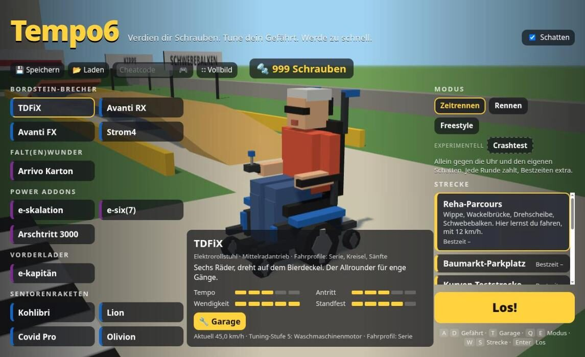
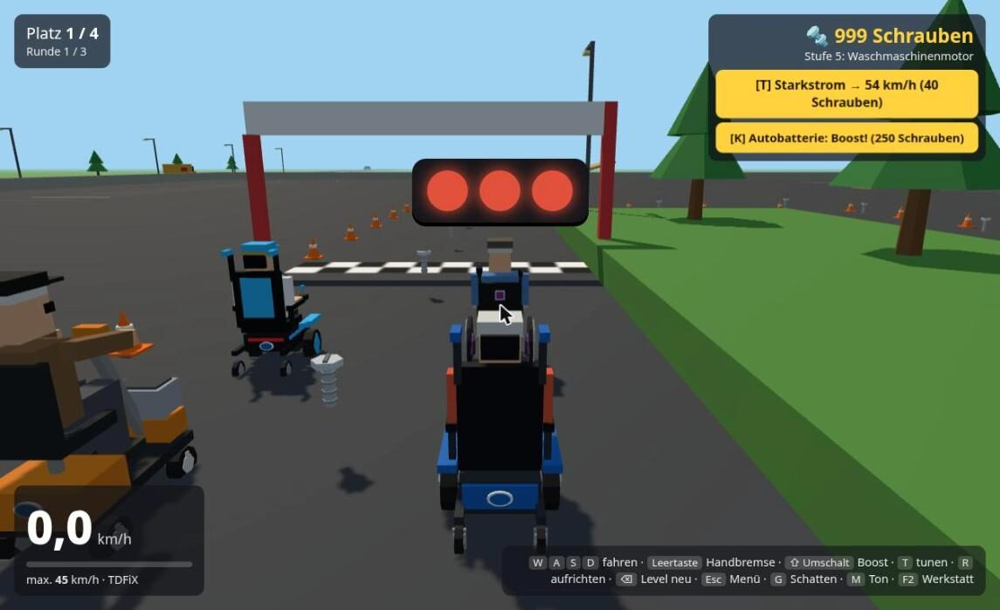
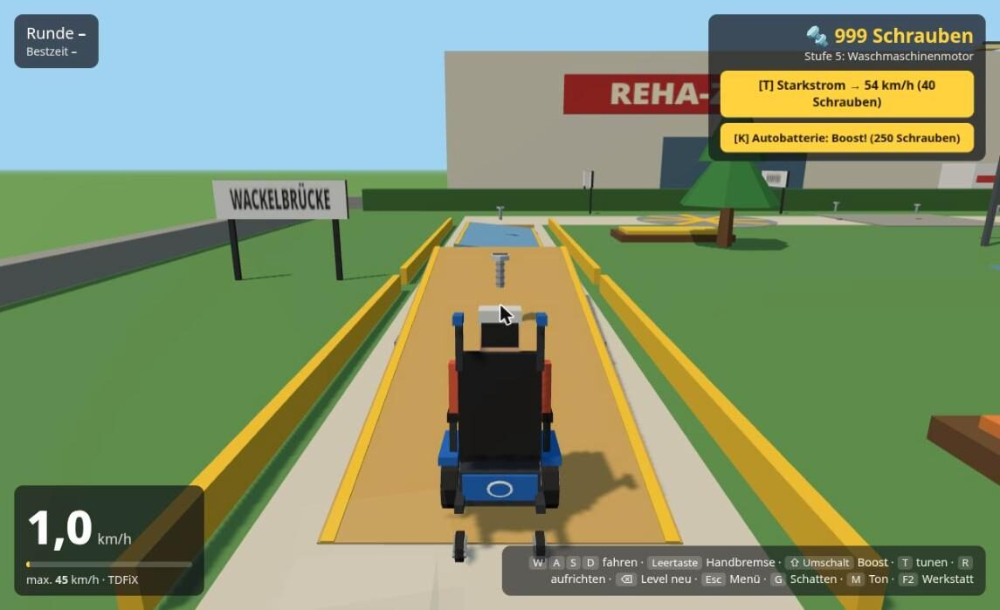
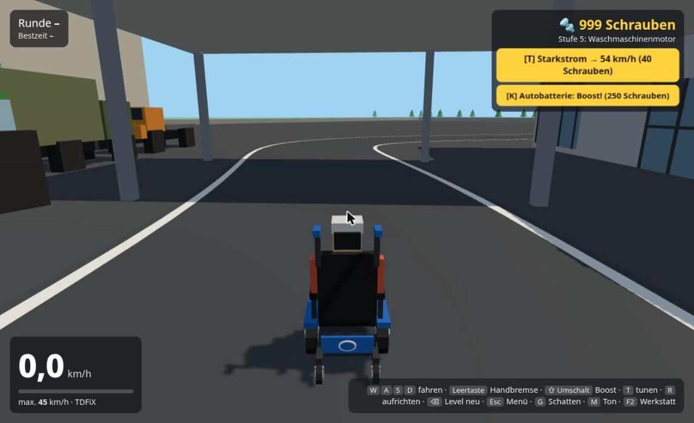
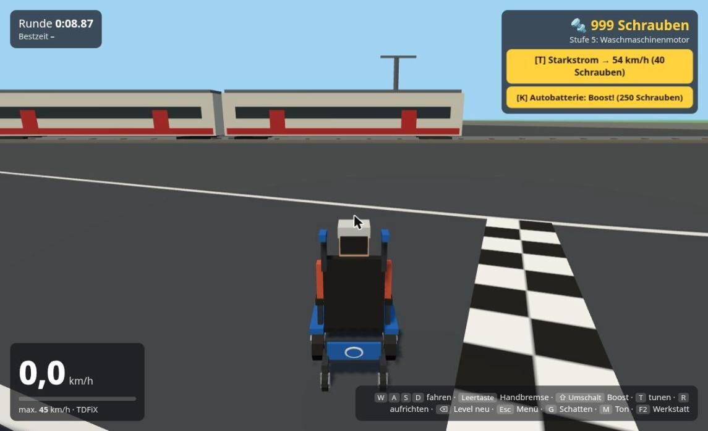
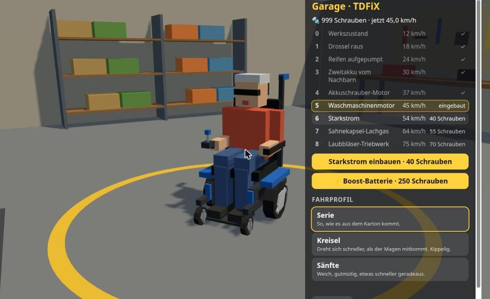

**English** · [Deutsch](README.de.md)

# Tempo6

**▶ Play in your browser: [technikweber.github.io/Tempo6](https://technikweber.github.io/Tempo6/)** · on a computer or a phone held sideways, nothing to install, no sign-up.

A racing game with power wheelchairs and mobility scooters. Every vehicle starts at 12 km/h (on paper: the legal 6) in the Reha-Parcours, a training course with a seesaw, a rocking bridge and a balance beam. Get through once and the throttle comes off; then earn Schrauben (screws) with laps, races and stunts and spend them on increasingly questionable tuning until 75 km/h. The game itself is in German.

<p align="center">
  
  
  
  
  
  
</p>

## What's in it

- **Modes:** time trial against the clock and your own ghost, a three-lap race against three others, freestyle for stunt chains, and an experimental crashtest.
- **Tracks:** Reha-Parcours, DIY-store car park, curve test ground, Talstadt works, the old works at Porta Westfalica, an old airfield, a playground of ramps, a stadium circuit, a long hill circuit and the crashtest ground.
- **Tuning:** eight stages up to 75 km/h, a boost battery, three driving profiles per vehicle, all in the garage too.
- **Save:** kept in the browser, and with "Speichern"/"Laden" as a file that survives clearing the browser's data.

## Vehicles

All model names are made up; the vehicles are loosely inspired by real product categories. There are no maker names, only a colour badge.

Every vehicle has three driving profiles to choose from in the garage. While the dev server runs, the chosen ones are written to `profile-choices.json`.

| Model | Category | Character |
| --- | --- | --- |
| TDFiX | Power wheelchairs | Mid-wheel drive, six wheels, turns on the spot |
| Avanti RX | Power wheelchairs | Rear-wheel drive, fast, prefers wide arcs |
| Avanti FX | Power wheelchairs | Front-wheel drive, pulls round corners, tail-happy |
| Strom4 | Power wheelchairs | Heavy rear-wheel drive, very stable |
| Arrivo Karton | One-piece folder | Light folding power chair, nimble |
| e-skalation | Power Addons | Hub motors, thrust in push strokes |
| e-six(7) | Power Addons | Hub motors with a joystick, optional attendant control |
| Arschtritt 3000 | Power Addons | Pusher wheel at the back, steered and braked by hand |
| e-kapitän | Tractor unit | Front-mounted drive, three wheels, fastest |
| Kohlibri | Mobility scooters | Tiny, agile, tippy |
| Lion | Mobility scooters | Compact |
| Covid Pro | Mobility scooters | The classic with a basket |
| Olivion | Mobility scooters | Long, heavy, fast, huge turning circle |

Vehicles and tracks are unlocked with Schrauben. To try everything: add `?demo` to the address for a show round with everything open that saves nothing.

## Run

```sh
npm install
npm run dev      # http://localhost:5173
npm test         # headless physics and game logic tests
npm run build    # static build in dist/
npm run deploy   # publish the build to technikweber.github.io/Tempo6/
```

The source stays in this repo; `npm run deploy` puts only the built game into the `Tempo6/` folder of the blog repo, which GitHub Pages serves.

## Controls

| Action | Keyboard | Gamepad |
| --- | --- | --- |
| Drive / steer | WASD or arrow keys | Triggers / left stick |
| In the air: turn and shift / tip the nose, stretch the jump | Steer / throttle and brake | left stick / triggers |
| Handbrake | Space | A |
| Boost (car battery on the lap) | Shift or B | B / RB |
| Buy next tuning stage | T | X |
| Back on the wheels | R | Y |
| Restart the level | Backspace | Back |
| Back to the start screen | Esc | Start |
| Sound on/off | M | |
| Garage (on the start screen) | T | |
| Workshop (live handling tuning; after a cheat code) | F2 | |

On a phone held sideways: steering strip bottom left with "aufrichten" (upright) and "neu" (restart) above it, throttle (big), reverse, handbrake and boost bottom right, menu top left. "Vollbild" on the start screen goes full screen.

## Architecture

- `src/sim/`: physics and game rules ([Rapier](https://rapier.rs) raycast vehicle, fixed 60 Hz step). No rendering or DOM, so it runs headless in the tests.
- `src/render/`: [three.js](https://threejs.org) scene; all models are built from primitives in code.
- `src/input/`: keyboard, gamepad and touch merged into one driving intent.
- `src/config/`: tuning stages, vehicle specs and handling parameters.
- `src/tracks/`: tracks as plain data, used by both physics and rendering.
